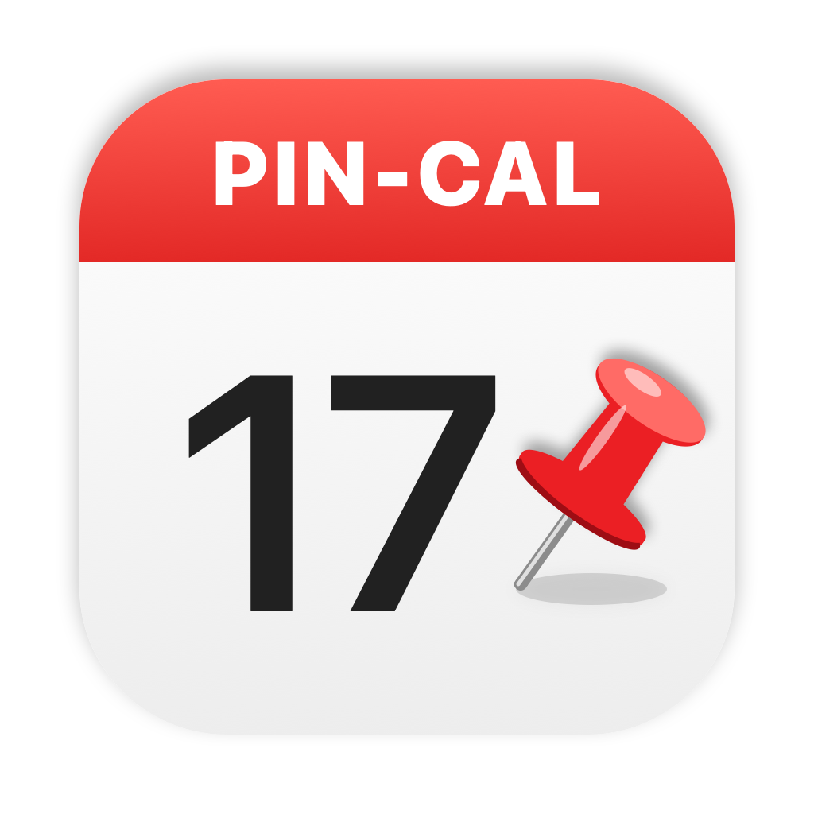

# Pin-Cal

Pick free slots from your Apple Calendar and copy them as text for an email, like *Share availability* in Notion Calendar, without switching calendar apps.

Pin-Cal is a small Dock app that shows all calendars from Calendar.app (iCloud, Google, Exchange, …) in a week view. Drag over free time, press **⌘C**, and paste:

```
I'm available at the following times:
• Wednesday 4 November: 10:00–11:00, 14:00–15:30
• Thursday 5 November: 09:00–10:00
```

Pin-Cal only writes to your calendars when you press **Reserve**, and nothing leaves your Mac.

## Features

- Week view mirroring every calendar in Calendar.app, live-updating, with a Calendar.app-style sidebar (checkboxes per calendar, mini month)
- **Drag** to select any slot (snaps to 15 min), or set a fixed length and **click** to place it
- Click a slot to remove it; drag its top/bottom edge to resize
- Slots that overlap an event turn orange
- Copy in **English, Dutch, German, French or Spanish** (switch per copy, with local date and time conventions), as plain text plus rich text for Mail/Outlook
- **Write your own message** per language in Settings, with Markdown (`**bold**`, `*italic*`, `[links](https://…)`, `- lists`) and placeholders `{slots}`, `{count}` and `{timezone}`. Includes a live preview
- **Reserve** the selected slots as tentative events (title configurable; default “Voorlopig”, Dutch for “tentative”) in a separate *Pin-Cal* calendar (or one you choose), so nothing else gets planned there while you wait for an answer. Reservations show striped; click one to release it, or the whole batch at once
- Optional menu bar icon (off by default)
- Settings: which calendars count as busy, working hours, weekends, intro line, time zone note, custom message, reservation calendar and title
- Events marked *free* and declined invitations never count as busy

Shortcuts: ⌘C copy · ⌘R reserve · ⌘⌫ clear · ⌘← / ⌘→ previous/next week · ⌘T today · ⌘, settings

## Custom message

Turn on **Settings → Copy → Write my own message** and write something like:

```markdown
Hi,

Would one of these work for a **30-minute call**?

{slots}

Times are in {timezone}. Or pick a time on [my page](https://example.com).
```

| Syntax | Result |
| --- | --- |
| `{slots}` | The selected times, one line per day (appended if left out) |
| `{count}` | Number of selected slots |
| `{timezone}` | Your time zone, e.g. CET |
| `**bold**` / `*italic*` | **bold** / *italic* |
| `[text](https://…)` | A link (http, https and mailto only) |
| `- item` | List item |
| empty line | New paragraph |

Rich-text apps (Mail, Outlook) get the formatting; plain-text fields get the text without the symbols.

## Requirements

macOS 26 (Tahoe) or later.

## Install

### From a release

Download `Pin-Cal.zip` from [Releases](../../releases), unzip it and move `Pin-Cal.app` to `/Applications`.

The app is not notarized, so macOS blocks the first launch. Either right-click → **Open**, or run:

```sh
xattr -dr com.apple.quarantine /Applications/Pin-Cal.app
```

### From source

```sh
brew install xcodegen
xcodegen generate
xcodebuild -project PinCal.xcodeproj -scheme PinCal -configuration Release -derivedDataPath build build
open build/Build/Products/Release/Pin-Cal.app
```

Run the tests for the core logic (busy-time calculation, slot merging, text formatting):

```sh
swift test --package-path Packages/PinCalCore
```

## License

MIT
